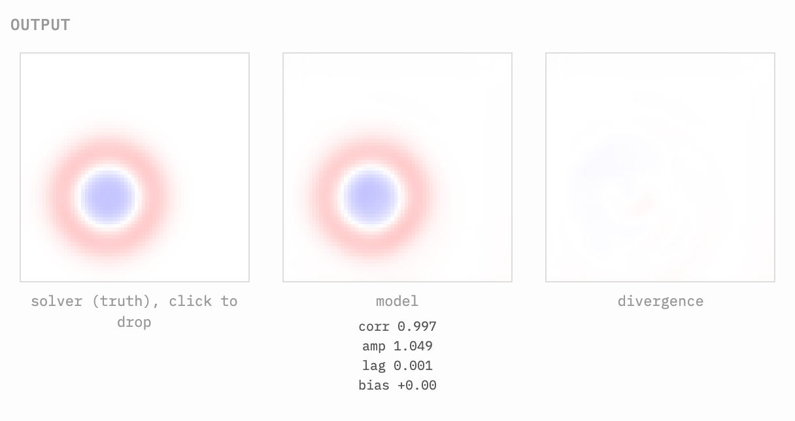
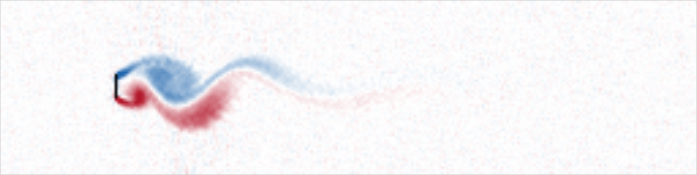

# jacobi2000

My personal physics project: small learned models and solvers on grids, with their own Rust inference engine. Models are trained in PyTorch; inference runs on WebGPU where there is one, on CPU threads otherwise, and on a single thread as the last resort, natively and in the browser from the same source.

## Crates

| Crate | What it is | Where it is used |
|---|---|---|
| `lean-runtime` | The wgpu and wasm plumbing an engine needs before its own kernels: the backend ladder (WebGPU, then CPU threads, then one CPU thread, by capability only), device acquisition, buffers, pipelines and the wasm threads pool. No model or physics types. | Every engine below. Derived from the runtime work in [idle-intelligence/llm-web](https://github.com/idle-intelligence/llm-web); see [its README](crates/lean-runtime/README.md). |
| `solvers` | Reference solvers in pure Rust: 2D shallow water, a 2D weakly compressible SPH, and particle splatting. | `engine`, `engine-cli` and `web`. |
| `engine` | Inference for the shallow-water model: CPU (one thread or rayon) and WebGPU forward passes, with hand-written WGSL kernels, reading the `model.safetensors` + `config.json` checkpoints the PyTorch export writes. | `engine-cli` and `web`. The trained model is [ilnmtlbnm/jacobi2000-model20](https://huggingface.co/ilnmtlbnm/jacobi2000-model20) on Hugging Face. |
| `engine-cli` | `rollout` (step a checkpoint next to the solver), `eval-metrics` (score rollouts at several horizons) and `dump-dataset` (write solver trajectories for training). | The command lines below. |
| `web` | The wasm build of `engine` and the solver for the browser. | The demo page in `web/` (run locally, see below). |
| `fhp` | The FHP-III lattice gas (Frisch, Hasslacher and Pomeau), with ternary and signed ternary variants: a per-site reference, a bit-sliced CPU engine and a wgpu/WGSL engine that agree bit for bit. | The dev page in `crates/fhp/www`; a trucs.ai page is coming. [Its README](crates/fhp/README.md) has the model, the collision circuit and the sources. |
| `jacobi` | 2D Laplace by Jacobi iteration as a bit-sliced gate circuit at 4, 8, 12 and 16 bits, next to integer and f32 references, on CPU and WGSL. | The dev page in `crates/jacobi/www`. |
| `life-models` | The three small Game of Life models (BERT of Life, the 9-number MLP and the toroidal stencil model), CPU and WGSL forward passes over a whole board. | The models come from [idle-intelligence/llm-life](https://github.com/idle-intelligence/llm-life), with weights at [idle-intelligence/stencil-life](https://huggingface.co/idle-intelligence/stencil-life); that project's demo is [trucs.ai/llm-life](https://trucs.ai/llm-life/). |

Also in the repo: `training/jacobi2000_pt` (the PyTorch model, training loop, curriculum and export), `web/` (the shallow-water demo page) and `docs/runs/` (dated research-log entries: parameters, commands, results).

## Shallow water

A PDE solver, learned as one transformer over the whole space-time grid. Give the model some values (an initial condition, a few sensor readings, a target state) and blanks for the rest, and it fills in the blanks by iterating to a fixed point. Running the simulation forward, rewinding a state to see its past, and reconstructing hidden fields from sparse measurements are the same call with different values marked as known. The name comes from Jacobi's iterative method: every point of the grid is updated at once from its neighbors, and this is repeated until the field stops changing. The first system I trained it on is 2D shallow water.



*The demo page after 40 ticks. Left: the classical solver. Middle: the model, with its correlation to the solver (0.997 here). Right: the difference between the two.*

### Results

- The best model (`model20`: 128 wide, 4 layers, 995,843 parameters, trained with mass and energy projection on) has a correlation with the solver of 0.9997 at 10 ticks, 0.9988 at 25 ticks and 0.9954 at 50 ticks. At 50 ticks its amplitude ratio is 1.03 and its wavefront lag is -0.007 cells (`docs/runs/2026-09-19-step6.md`).
- Along a projected rollout its maximum relative energy violation is 0.000e0, against a bound of 1e-6 (`docs/runs/2026-09-19-acceptance-2.md`).
- Rewinding works over short horizons. A forward model steps a state N ticks ahead, and a reverse model, trained with the time axis flipped, steps it back. The correlation with the original state is 0.98 after 10 ticks, 0.93 after 25 and 0.80 after 50, with the reverse model trained at the same viscosity as the forward one (0.9817, 0.9263 and 0.8025 in `docs/runs/2026-09-20-rewind-round-trip.md`). The same table shows what is hard: amplitude comes back 10 to 25 percent low, and a reverse model trained without viscosity does worse at every horizon.
- A full-attention model of the same kind (`model12`, no stencil mask, no energy projection) fails the same evaluation: its correlation is 0.2242 at 25 ticks and -0.0637 at 50 ticks, where `model20` stays above 0.99 (`docs/runs/2026-09-19-acceptance-2.md`). That baseline differs from `model20` in both choices at once, so this run does not say which of the two matters more.
- A 5x wider model (256 wide, 6 layers, 5,427,971 parameters), trained on a desktop GPU, does not beat `model20` on this evaluation at matched horizons, despite more parameters and more training steps (`docs/runs/2026-09-19-step6.md`).

### Run the trained model

Requires a Rust toolchain. The Rust crates run inference on the CPU, or on a GPU through wgpu (Metal on macOS, Vulkan on Linux) when built with `--features wgpu`. Tests need no GPU.

```
cargo build --release
cargo test --workspace
```

`rollout` loads a `model.safetensors` + `config.json` checkpoint (the format the PyTorch training export writes, `docs/pytorch-training.md`), steps it next to the reference solver from a built-in initial condition, and prints the model's correlation against the solver every tick. The trained `model20` is on Hugging Face. Download it and run it:

```
pip install huggingface_hub
hf download ilnmtlbnm/jacobi2000-model20 --local-dir models/model20
cargo run -p engine-cli --release --bin rollout -- \
    --model models/model20 --steps 50 --backend cpu
```

`--backend auto|cpu|webgpu` picks the backend (`auto`, the default, tries WebGPU and falls back to CPU); `--backend webgpu`/`threads` need this crate built with `--features wgpu`/`threads` respectively. `--case drop|dam_break` picks the initial condition, and `--out field.npy` dumps the final decoded height field as a NumPy `.npy` file.

`eval-metrics` scores a checkpoint's rollouts against the solver at several horizons:

```
cargo run --release -p engine-cli --bin eval-metrics -- --model <checkpoint-dir> --project-energy true
```

### Browser

`web/` is a self-contained demo page (solver and model side by side, a divergence panel, and controls for time and viscosity). It needs the wasm build in `web/pkg` and a populated `web/model/` directory of exported checkpoints, neither of which is committed (see `web/README.md`).

```
scripts/build_web.sh                                  # needs wasm-pack
tools/export_web_models.sh model20=models/model20     # a checkpoint directory, see above
python3 -m http.server 8000 --directory web
```

Then open `http://localhost:8000`. (`cd web && npm install && npm test` runs the headless check of the page.)

### Train one yourself

Training is PyTorch, in `training/jacobi2000_pt`. The solver stays in Rust: `dump-dataset` writes the trajectories once, and Python reads the flat files.

```
python3 -m venv .venv
. .venv/bin/activate
pip install -e training
cargo run --release -p engine-cli --bin dump-dataset -- --pool 24 --out data/ds
python -m jacobi2000_pt.train --dataset data/ds --steps 300 --out artifacts/model
cargo run -p engine-cli --release --bin rollout -- \
    --model artifacts/model --steps 50 --backend cpu
```

## The FHP lattice gas

`crates/fhp` is the FHP-III lattice gas (Frisch, Hasslacher and Pomeau), with ternary and signed ternary variants, as a per-site reference and bit-sliced CPU and WGSL engines that agree bit for bit. Flow past a plate forms a von Karman vortex street (below: the signed ternary variant on WebGPU, a 4096 x 1024 lattice after 13,000 steps, Reynolds number about 200, coloured by vorticity). The dev page at `crates/fhp/www` runs it in the browser; `crates/fhp/README.md` has the model, the collision circuit, the commands and the sources, and [`crates/fhp/REPORT.md`](crates/fhp/REPORT.md) is the technical report on the signed ternary model.



## The bit-sliced Jacobi stencil

`crates/jacobi` solves the 2D Laplace equation by Jacobi iteration as a gate circuit at 4, 8, 12 and 16 bits, next to integer and f32 references. The same circuit runs on u64 words on the CPU and as WGSL on the GPU.

## The Game of Life models

`crates/life-models` runs the three small models from [idle-intelligence/llm-life](https://github.com/idle-intelligence/llm-life) over a whole board: BERT of Life (one encoder layer over the 9 neighbourhood cells as tokens), the 9-number MLP, and the toroidal stencil model, which has no position embedding, so a model trained at 16x16 runs on a board of any size. CPU and WGSL forward passes read the same `model.safetensors` + `config.json` checkpoints.

## License

MIT. See `LICENSE`.
