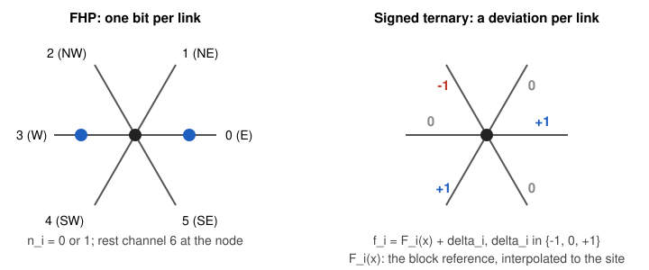
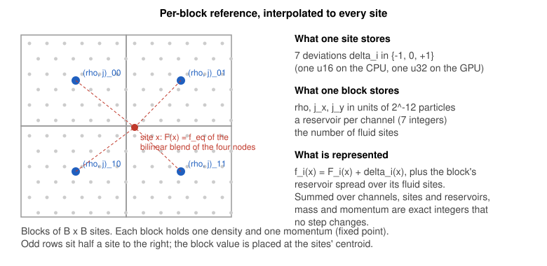
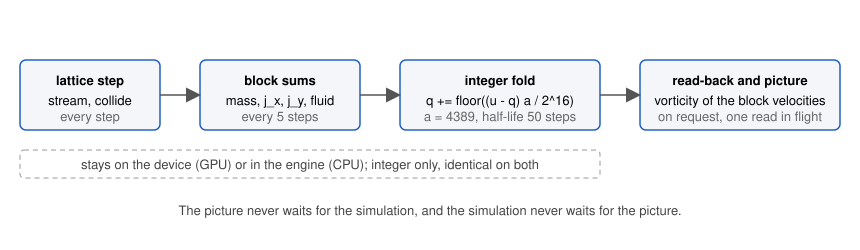

# The signed ternary FHP lattice gas

A technical report on the model behind the [flow](https://trucs.ai/flow/) page: what it is, why it is a fluid, what it conserves, how the picture is made, what was measured, and where each piece lives in the code. Part I is written for a physicist who has not seen the code. Part II walks through the implementation. The report is the detailed reference for the blog post [Cellular automata in science](https://trucs.ai/blog/cellular-automata/) and for the flow page; both link here.

Contents

- [Abstract](#abstract)
- Part I: the model
  - [1. Background](#1-background)
  - [2. The model](#2-the-model)
  - [3. Averaging and the picture](#3-averaging-and-the-picture)
  - [4. Results](#4-results)
  - [5. What is new](#5-what-is-new)
  - [6. Limitations and open questions](#6-limitations-and-open-questions)
- Part II: the code
  - [7. Implementation](#7-implementation)
  - [8. How to reproduce](#8-how-to-reproduce)
- [References](#references)

## Abstract

The FHP lattice gas (Frisch, Hasslacher and Pomeau, 1986) is a fluid made of bits: one particle or none on each of the six links of a triangular lattice, moved and collided by a fixed rule. It follows the Navier-Stokes equation at large scales, but it is noisy, its viscosity is high, and its advection term carries a density-dependent factor $g(\rho) < 1$. The signed ternary variant described here keeps the bit-level structure and changes what a link stores. Each channel holds a signed deviation $\delta_i \in \{-1, 0, +1\}$ from a reference occupation $F_i(\mathbf{x})$, where the reference is the polynomial equilibrium of a density and a momentum kept per block of $B \times B$ sites and interpolated to every site. The deviations stream and collide as an integer lattice gas with three states per channel; the reference carries the smooth flow and is re-estimated from block sums every $N$ steps. Streaming across a reference gradient adds the reference difference by stochastic rounding, and the rounding residuals and the overflow of the three-valued range are parked in a per-block reservoir, so that the represented mass and momentum are exact integers that no step changes. Everything but the deviations is fixed point, in units of $2^{-12}$ particles, so a CPU engine and a WGSL GPU engine agree bit for bit. Measured on the same lattice, plate and Mach number, the signed model has a Galilean factor $g = 0.99$ independent of density (FHP-III at its operating density: $0.36$), a block-velocity noise 7 to 9 times lower than FHP-III, and a Reynolds number per lattice length about 3.4 times higher; its viscosity is between the ternary and the FHP-III values because the reference mechanism adds a numerical viscosity of about $0.08$. The 4096 x 1024 vortex street reaches $Re \approx 200$ where FHP-III reaches 59. I found no earlier lattice gas that stores signed ternary deviations from a per-block equilibrium.

# Part I: the model

## 1. Background

### 1.1 HPP and FHP

In 1973 Hardy, Pomeau and de Pazzis proposed a fluid made of particles on a square lattice [[1]](#references): at each tick every particle moves one link, and when two meet head on they leave at right angles. Mass and momentum are conserved, but the square lattice has too few symmetries, and the large-scale equations are not isotropic: the stress tensor depends on the lattice directions.

Frisch, Hasslacher and Pomeau showed in 1986 that on the triangular lattice, where each node has six neighbours, the same kind of gas does give the Navier-Stokes equation at large scales [[2]](#references); Wolfram gave the general theory the same year [[3]](#references). The model is called FHP. A node holds up to six moving particles, one per direction, and in the variants with rest particles a seventh that does not move. A step has two phases: streaming, where every particle moves one link along its direction, and collision, where the particles arriving at a node are redistributed among the directions by a rule that keeps the number of particles and the vector sum of their velocities. FHP-I has only the head-on pair and the symmetric triple collisions; FHP-II adds a rest particle and the collisions that involve it; FHP-III uses every collision that conserves mass and momentum (the "collision-saturated" model), and has the lowest viscosity of the three [[4]](#references), [[5]](#references).

Two things make the model a fluid rather than a toy. First, the equilibrium is a Fermi-Dirac distribution over the channels, forced by the exclusion of more than one particle per channel, and its low-velocity expansion gives a pressure, a momentum flux and a viscosity in closed form. Second, the lattice is isotropic enough that the fourth-rank tensor built from the six directions has the symmetry Navier-Stokes needs.

### 1.2 What is wrong with it

Three things, all consequences of one bit per channel.

- Noise. A channel is 0 or 1, so the occupation of a site fluctuates by order one. Any velocity field has to be read as an average over blocks of sites and over time, and a $16 \times 16$ block at the usual densities still has a velocity noise of a few percent of the sound speed.
- Viscosity. The collisions relax the stress at a rate set by the rule; FHP-III at its best density has a kinematic viscosity around $0.1$ in lattice units. The Reynolds number a lattice of length $L$ can reach is $Re = U L g / \nu$ at fixed Mach number $U / c_s$, so a high viscosity means a large lattice.
- The Galilean factor. The Fermi-Dirac equilibrium gives the momentum flux $\Pi_{\alpha\beta} = p\,\delta_{\alpha\beta} + g(\rho)\,\rho u_\alpha u_\beta$ with $g(\rho) = \frac{7}{12}\frac{1 - 2d}{1 - d}$ for FHP-III at density $d$ per channel [[5]](#references). The fluid advects itself at $g u$ instead of $u$. For incompressible flow one rescales time and viscosity ($t' = g t$, $\nu' = \nu / g$) and recovers Navier-Stokes, but $g$ is at most about $0.5$ at the useful densities, which costs a factor $g$ in the Reynolds number and leaves a velocity-dependent pressure.

### 1.3 Integer lattice gases

Boghosian, Yepez, Alexander and Margolus generalised FHP to channels that hold $0$ to $2^L - 1$ particles [[6]](#references). They derived the product-form equilibrium, showed that $g(\rho) = 1$ can be reached with enough occupancy, and that the viscosity and the relative noise fall as the occupancy grows. Blommel and Wagner later built an integer lattice gas whose Monte Carlo collision recovers the entropic lattice Boltzmann equilibrium with Poisson fluctuations [[7]](#references). In both, a channel stores an absolute count.

The ternary variant in this crate (`src/ternary/`) is the smallest integer lattice gas on the FHP lattice: 0, 1 or 2 particles per channel, $3^7 = 2187$ states per site. Measured against FHP-III it buys about $1.8\times$ the Reynolds number per lattice length through a stress-reversing collision rule, with the same $g$ (Section 4). It is the starting point of the signed model: a signed deviation in $\{-1, 0, +1\}$ is a count in $\{0, 1, 2\}$ shifted by one, so the ternary collision table applies to it unchanged.

### 1.4 Lattice Boltzmann

McNamara and Zanetti replaced the Boolean occupations by their expected values, real numbers evolved by the Boltzmann equation of the lattice gas [[8]](#references); Higuera and Jiménez linearised the collision [[9]](#references), and Qian, d'Humières and Lallemand introduced the BGK relaxation with a polynomial equilibrium that has $g = 1$ by construction [[10]](#references). This removed the noise and the Galilean factor at once, at the price of floating-point arithmetic per site and of exact conservation (only to round-off). The lattice Boltzmann method became the standard, and lattice gases were mostly left behind.

The reference of the signed model is a lattice-Boltzmann-like object: a polynomial equilibrium of a coarse density and momentum. What differs is that it never collides or streams on its own. It is a bookkeeping device for the smooth part of the field; the dynamics are carried by the ternary deviations, and conservation is exact in integers.

## 2. The model

### 2.1 Lattice and notation

The lattice is triangular, stored on a $W \times H$ array with odd rows shifted half a site to the right [[5]](#references). Site $(x, y)$ sits at $X = x + \tfrac{1}{2}(y \bmod 2)$, $Y = y\sqrt{3}/2$. The six moving directions are $\mathbf{c}_i = (\cos(i\pi/3), \sin(i\pi/3))$ for $i = 0, \dots, 5$ (E, NE, NW, W, SW, SE), and channel 6 is the rest channel with $\mathbf{c}_6 = 0$. Streaming is periodic in both directions. The sound speed of the seven-velocity lattice gas with the equilibrium used below is $c_s^2 = 3/7$.



*A node and its six links. Left: FHP holds one bit per link. Right: the signed model holds a deviation $-1$, $0$ or $+1$ per link, measured against the local reference.*

Mass and momentum are counted in integer units throughout: a particle in channel $i$ contributes $1$ to the mass and $(2 c_{ix},\ 2 c_{iy}/\sqrt{3}) \in \{-2, \dots, 2\} \times \{-1, 0, 1\}$ to the momentum, so that every sum is an integer.

### 2.2 The representation

A site holds seven deviations $\delta_i \in \{-1, 0, +1\}$. The occupation it represents in channel $i$ is

$$f_i(\mathbf{x}) = F_i(\mathbf{x}) + \delta_i(\mathbf{x}),$$

where $F_i(\mathbf{x})$ is the reference, a real number stored in fixed point (Section 2.4). The reference holds the smooth part of the flow; the deviations hold the fluctuations around it and whatever the reference has not caught up with. With $n_i = \delta_i + 1 \in \{0, 1, 2\}$ a site's deviations are exactly a state of the ternary lattice gas, and the classes of constant $\sum_i \delta_i$ and $\sum_i \mathbf{c}_i \delta_i$ are the ternary model's mass and momentum classes, because the six moving velocities sum to zero. A collision table built for the ternary gas therefore conserves the represented mass and momentum of a site exactly, whatever the reference at that site is.

A uniform reference that is never re-estimated turns the model into the ternary lattice gas, state for state, and a test checks this bit for bit (Section 7.6). With a uniform reference nothing physical changes: the gas is the ternary gas relabelled. The design question is how to let the reference carry the flow, and the rest of this section is the answer.

The deviation gas is run at half filling: the reference is chosen so that the mean deviation is zero, which puts the ternary gas at its density $1$ per channel, where its own Galilean factor vanishes by particle-hole symmetry and its Boltzmann viscosity is lowest ($0.0146$ with the collision rule used here, Section 4.1). The reference occupation per channel at rest is a free parameter, $n_0$; the page uses $n_0 = 4$, so a channel represents $4 \pm 1$ particles and a site about $28$. The relative noise of a channel is then $\sqrt{2/3}/n_0 \approx 0.20$, against $1.6$ for FHP-III at density $0.28$.

### 2.3 The reference equilibrium

The reference is the polynomial equilibrium of a density $\rho$ and a velocity $\mathbf{u}$ on the seven channels,

$$F_i = \rho\left(\tfrac{1}{7} + \tfrac{1}{3}\,\mathbf{c}_i\cdot\mathbf{u} + \tfrac{2}{3}(\mathbf{c}_i\cdot\mathbf{u})^2 - \tfrac{1}{6}u^2\right) \quad (i < 6), \qquad F_6 = \rho\left(\tfrac{1}{7} - u^2\right).$$

Its moments are exact: $\sum_i F_i = \rho$, $\sum_i \mathbf{c}_i F_i = \rho\mathbf{u}$ and $\sum_i \mathbf{c}_i \mathbf{c}_i F_i = \tfrac{3}{7}\rho\,\mathbf{I} + \rho\,\mathbf{u}\mathbf{u}$. The momentum flux is $\rho\mathbf{u}\mathbf{u}$ with coefficient one, so whatever momentum sits in the reference is advected with $g = 1$, at any density. This is where the Galilean factor is fixed: not by the ternary bits, but by moving the flow into a reference whose flux is right by construction.

The sound speed $c_s^2 = 3/7$ is the one of the deviation gas at half filling, whose linear response is $\langle\delta_i\rangle = m/7 + \mathbf{c}_i\cdot\mathbf{j}/3$; keeping the two equal means a sound wave sees one medium. The price is a third moment $\sum_i \mathbf{c}_i\mathbf{c}_i\mathbf{c}_i F_i$ that is not $c_s^2 \rho$ times the symmetric combination of $\mathbf{u}$, which in a Chapman-Enskog expansion lands in the trace of the viscous stress, a positive bulk viscosity proportional to $1 - 2c_s^2 = 1/7$. The shear viscosity is not affected.

### 2.4 Blocks, fixed point and interpolation

The reference is defined by one density and one momentum per block of $B \times B$ sites, $(\rho_k, \mathbf{j}_k)$, and interpolated bilinearly to the sites before the equilibrium is evaluated: $F_i(\mathbf{x}) = f^{eq}_i(\rho(\mathbf{x}), \mathbf{j}(\mathbf{x})/\rho(\mathbf{x}))$. The block value is the mean over the block's fluid sites, and it is placed at those sites' centroid, which, because the odd rows are shifted, is a quarter of a site to the right of the block's column centre. Interpolation is done at the true positions $X$ of the sites. (The first version interpolated at the column index $x$; that put a zigzag error of $\pm\tfrac{1}{4}$ site on the reference, alternating with the row parity, whose product with the bilinear weights left a mixed-derivative term of one fixed sign, and the vortex street leaned one way in eight runs out of eight. Section 4.5 has the mirror test that found it.)



*The reference lives on blocks and is interpolated to the sites. One block of $B \times B$ sites stores a density, a momentum and a reservoir; one site stores seven deviations.*

Every quantity but the deviations is an integer in units of $2^{-12}$ particles: block densities, block momenta in the integer momentum units, the per-site reference, the reservoirs and the block sums. The interpolation weights are integers out of $4B$ in $x$ (quarter sites) and $2B$ in $y$ (half rows), and the result is floored after each axis. The equilibrium is evaluated in integers too: $\mathbf{u} = \mathbf{j}/\rho$ to $2^{-16}$ by a two-digit long division, the quadratic terms by a 64-bit product shifted down, and $168 F_i$ and $28 F_6$ truncated. The fixed-point reference is within a few units of $2^{-12}$ of the real one per channel, and its mass and momentum within $7$ to $12$ units, which a test checks. Fixed point is what makes the CPU and GPU engines agree bit for bit (Section 7.5) and what makes conservation exact rather than exact to round-off.

The page ties the block to the plate: $B = H/64$, so the plate of $H/8$ rows spans eight blocks ($B = 8$ at $H = 512$, $16$ at $H = 1024$). With $3.5$ blocks across the plate the wake turns into bands (Section 6).

### 2.5 Streaming with the reference correction

A deviation moves like a particle: $\delta_i$ at $\mathbf{x} - \mathbf{c}_i$ arrives at $\mathbf{x}$. If the reference were the same at both sites, that would stream the represented occupation exactly. Across a reference gradient it does not, because the arriving deviation is now measured against $F_i(\mathbf{x})$ instead of $F_i(\mathbf{x} - \mathbf{c}_i)$. The streaming step therefore adds the difference, rounded stochastically to an integer:

$$\delta_i(\mathbf{x}) \leftarrow \delta_i(\mathbf{x} - \mathbf{c}_i) + \mathrm{SR}\big(F_i(\mathbf{x} - \mathbf{c}_i) - F_i(\mathbf{x})\big),$$

where $\mathrm{SR}(r) = \lfloor r + U \rfloor$ with $U$ uniform on $[0, 1)$. Stochastic rounding is unbiased, $\mathbb{E}[\mathrm{SR}(r)] = r$, so the represented occupation streams exactly in expectation; with $r$ on the $2^{-12}$ grid and $U$ a 12-bit random fraction, the expectation is exact, not approximate. With a smooth reference the correction is of order $\mathbf{c}\cdot\nabla F$ per step, delivered as rare $\pm 1$ kicks; this is the gradient source term of a Chapman-Enskog expansion, in integer form.

The result is then clamped to $\{-1, 0, +1\}$. The clamping is the price of a bounded representation, and the next section says where the clipped amount goes.

### 2.6 Reservoirs and the conservation invariant

Each block keeps a reservoir $R_{k,i}$ per channel, an integer in the same units. It is part of the represented state: its content belongs to the block, spread uniformly over the block's fluid sites, and it does not stream. Two things are added to it during streaming at every receiving site: the rounding residual $r - \mathrm{SR}(r)$ and the clipped overflow, that is, the amount by which $\delta_i + \mathrm{SR}(r)$ exceeded $\pm 1$.

The invariant is, per channel $i$,

$$T_i = \sum_{\mathbf{x}} \big(F_i(\mathbf{x}) + \delta_i(\mathbf{x})\big) + \sum_k R_{k,i} = \text{const},$$

and it holds exactly in the integer units. The argument is a line per phase.

- Streaming moves the term $F_i(\mathbf{x} - \mathbf{c}_i) + \delta_i(\mathbf{x} - \mathbf{c}_i)$ to the site $\mathbf{x}$, where it becomes $F_i(\mathbf{x}) + \delta_i'(\mathbf{x})$; the difference between what left and what arrived is exactly what the receiving block's reservoir receives, by construction of the residual and the overflow. Summed over a periodic lattice the reference differences cancel, so the per-channel total is unchanged.
- Collision changes the $\delta_i$ of a site within a class of constant $\sum_i \delta_i$ and $\sum_i \mathbf{c}_i \delta_i$. Per channel it is not conserved (it is not meant to be), but mass $\sum_i T_i$ and momentum $\sum_i \mathbf{c}_i T_i$ are, because the reference at the site is untouched.
- Re-estimation (Section 2.8) changes the reference and re-quantizes the deviations, and sets each block's new reservoir to the exact remainder of the block's content, so the block's content per channel is the same before and after.

Mass and momentum are therefore exact integers that no step changes; a test checks the totals after every step on the CPU, and another checks the GPU's read-back totals every hundred steps. The only non-conserving operations are the ones that should not conserve: the open boundary replaces the inlet and outlet zones with fresh inflow samples, and the plate's bounce-back reverses momentum.

Conservation holds per site in expectation as well: each site's represented occupation is unbiased, which a statistical test checks against the rounding variance $p(1 - p)$.

### 2.7 Collision

The deviations collide with the ternary lattice gas's table. States are grouped into classes of equal $(\sum_i n_i, \sum_i \mathbf{c}_i n_i)$, $495$ classes over the $2187$ states, and the collision maps a state to another member of its class. Two rules run on the GPU.

- `optimal`: within each class, the permutation that minimises $\sum_s \mathbf{Q}(s)\cdot\mathbf{Q}(\pi(s))$, with $\mathbf{Q}(s) = \big(\sum_i n_i (c_{ix}^2 - c_{iy}^2),\ \sum_i n_i\, 2 c_{ix} c_{iy}\big)$ the traceless stress of the state, found by the Hungarian algorithm; then the twelve images of that permutation under the lattice's rotations and reflections, each applied with probability $1/12$, so the rule is isotropic and doubly stochastic. A doubly stochastic rule has the uniform measure on each class as its invariant measure, which is semi-detailed balance, so the equilibrium is the product measure the theory assumes. Reversing the stress at each collision is what gives this rule its low viscosity.
- `chiral`: the bit-sliceable form of the same idea, a minimum-cost permutation that commutes with the $60^\circ$ rotation and its mirror image, chosen by one random bit per site. It has the same Boltzmann viscosity to three digits.

The page uses `optimal`. Two other rules exist in the code: `other` (every other member of the class with probability $1/(q - 1)$, the FHP-III choice applied to whole classes) and `uniform` (every member with probability $1/q$, the rule of [[6]](#references)). In Boltzmann theory at half filling they have $7$ to $10$ times the viscosity of `optimal` ($0.109$ and $0.143$ against $0.0146$), and measured in the signed model `other` gives $\nu \approx 0.19$ against $0.09$ to $0.11$: the gain is in the rule, not in the number of states.

### 2.8 Re-estimating the reference

Every $N$ steps, after the collision, the reference is re-estimated. Per block: the content per channel, $C_{k,i} = \sum_{\mathbf{x}\in k} (F_i(\mathbf{x}) + \delta_i(\mathbf{x})) + R_{k,i}$ over the fluid sites, is reduced to a mass and a momentum and divided by the number of fluid sites, which gives the new block values $(\rho_k, \mathbf{j}_k)$. The new per-site reference $F'$ is interpolated from them. Each fluid site's deviations are re-quantized,

$$\delta_i' = \mathrm{clamp}\big(\delta_i + \mathrm{SR}(F_i + R_{k,i}/n_k - F_i'),\ -1,\ 1\big),$$

where $n_k$ is the block's number of fluid sites: the old reference and the site's share of the parked reservoir are released into the field against the new reference. The new reservoir is then set to the exact remainder, $R'_{k,i} = C_{k,i} - \sum_{\mathbf{x}\in k}(F_i' + \delta_i')$, so the block's content per channel is unchanged by the re-estimate. Only the equilibrium is projected into the reference; the non-equilibrium part of the field, the viscous stress, stays in the deviations.

The re-estimate period trades speed against stability: $N = 4$ is about $2.5\times$ faster than $N = 1$ on the CPU at no measured cost in $g$ or $\nu$, but $B = 8$ with $N = 4$ diverges (Section 6), so the page uses $N = 1$ at $B = 8$ and $N = 4$ above. $B = 1$, a per-site reference, diverges at once: the reference then follows the per-site noise and feeds it back.

### 2.9 Boundaries

The flow past a plate is the setup of d'Humières and Lallemand [[5]](#references): a channel periodic in $y$, open in $x$, with a flat plate across the flow.

- The plate is bounce-back: an obstacle site reverses every moving deviation, $\delta_i \leftarrow \delta_{i+3}$. Obstacle sites hold the reference at rest, which is isotropic ($F_i = F_{i+3}$), so bouncing the deviations is exactly bouncing the represented occupation. The mismatch between the moving fluid reference next to the plate and the plate's own reference is handled by the streaming correction like any other gradient. The plate is $H/8$ rows tall and two columns wide, at $x = W/6$, one row off the centre line.
- The open boundary is the "wind tunnel" of [[5]](#references), applied every $32$ steps. The inlet (the first $32$ columns) and the outlet (the last $64$ columns) are refreshed: their blocks' values are set to the inflow density and velocity, their reservoirs are emptied, and every site in the zones gets fresh deviations drawn uniformly from $\{-1, 0, +1\}$, the half-filled measure. The inlet is $32$ columns wide, so what streams around the periodic seam from the outlet between two refreshes (at most $31$ columns) stays inside it. A refresh step is also a re-estimate step for the whole lattice.
- The initial state is the uniform inflow: block values at the inflow density and velocity, deviations sampled per site and channel from the capacity-2 distribution whose mean is the target minus the reference (half-filled where they agree). Nothing else is imposed; the street forms by itself.

The inflow density is $\rho = 7 n_0 = 28$, and the inflow speed $U$ is $0.2$ (Mach $0.31$) for the measurements below and on the dev page, $0.2$ or $0.25$ on the flow page depending on the layout.

### 2.10 Why it is a fluid, and the Reynolds number

For structures larger than a block and slower than $N$ steps, the momentum is in the reference, whose flux is $\rho\mathbf{u}\mathbf{u}$ exactly: $g = 1$, independent of density, with no exclusion bound. The part held in the deviations (sub-block structure, and whatever accumulated since the last re-estimate) is carried by a gas with $g = 0$, so $g$ measured on an advected wave is slightly below one and falls if $N$ or $B$ grows ($0.994$ at $B = 16$, $0.9985$ at $B = 8$, Section 4.2). The stress relaxes through the deviation collisions, so the shear viscosity is that of the ternary gas at half filling plus whatever the coupling to a moving reference adds; measured, the second part dominates (Section 4.1). The sound speed is $c_s = \sqrt{3/7} \approx 0.65$ in both the reference and the deviations.

The Reynolds number is

$$Re = \frac{U\,D\,g}{\nu}, \qquad D = \text{plate rows} \times \tfrac{\sqrt{3}}{2},$$

with the measured $g$ and $\nu$ of the configuration ($g = 0.9941$, $\nu = 0.1107$ at $B = 16$, $N = 4$; $g = 0.9985$, $\nu = 0.1150$ at $B = 8$, $N = 1$; both from Section 4). The page computes it with the measured mean $u_x$ of the fluid blocks in place of $U$, so the displayed value moves with the flow. At fixed Mach number the Reynolds number a lattice can reach is proportional to its length times $g/\nu$: $8.7$ to $9.0$ for the signed model, $4.6$ for ternary, $2.7$ for FHP-III (Section 4.3).

## 3. Averaging and the picture

### 3.1 Why average

A lattice gas is noisy by construction. Even in the signed model, where a channel fluctuates by $\pm 1$ around a reference of $4$, a single site's velocity is meaningless. The theory of independent half-filled deviations gives the standard deviation of the $x$ velocity over a block of $b \times b$ sites at rest as

$$\sigma_{u} = \frac{\sqrt{2}}{7\,n_0\,b},$$

which is $0.0032$ at $b = 16$, $n_0 = 4$ (measured: $0.0027$; FHP-III at density $0.28$ and the same block: $0.0248$). At the inflow speed $U = 0.2$ that is about $1.5\%$ of the flow per $16 \times 16$ block, or $3\%$ per $8 \times 8$ block, per sample. The picture is the vorticity, a derivative of the velocity between neighbouring blocks, which amplifies the block noise; a time average is what turns the field into a readable picture. Some noise is left on purpose: the page shows the fluid as it is, and the averaging is the minimum that makes the street visible.



*The averaging pipeline. Everything up to the read-back is integer arithmetic, kept on the device for the GPU engines and in the engine for the CPU engines, so the two give the same average to the bit.*

### 3.2 Block sums

After every step whose index is a multiple of $5$ (counted from the start of the simulation, so the average depends on the step count only and not on how the steps were batched), the engine sums the represented occupation over display blocks of $b \times b$ sites: mass, momentum $(2 j_x, 2 j_y/\sqrt{3})$ and the number of fluid sites. The represented occupation of a site is $F_i + \delta_i$ plus its share $R_{k,i}/n_k$ of its reference block's reservoir. The sums are in the $2^{-12}$ units shifted down by $4$ bits so that a $32 \times 32$ block fits an `i32`. The display block ($8$ on the flow page) is independent of the reference block.

### 3.3 The time average, in integers

Per display block the sample's velocity is $u = j/(2m)$ to $2^{-16}$ (a two-step integer division, after a common right shift that keeps every operand below $2^{22}$), and the running average $q$ is updated as

$$q \leftarrow q + \left\lfloor \frac{(u - q)\,a}{2^{16}} \right\rfloor, \qquad a = 4389,$$

the first sample replacing $q$. The weight $a/2^{16} = 0.0670 = 1 - 0.5^{1/10}$ halves the average over $10$ samples, that is, $50$ steps. If samples $5$ steps apart were independent, the average would reduce the per-sample noise by a factor $\sqrt{(2 - \alpha)/\alpha} \approx 5.4$; consecutive samples are correlated, so the real reduction is smaller (not measured). The average is an exponential moving average rather than a window so that it holds one state per block and never waits for a window to fill, and it is integer so that the CPU and the GPU produce the same bits. The GPU folds each sample into the average in the same command buffer as the block sums, with no read-back; the average is read back only when the page asks for a picture, one read in flight at a time, and the simulation keeps stepping while the read is pending. On the CPU the same integer fold runs in the engine after each sample.

### 3.4 Vorticity and the picture

The block velocities are $u_x = q_x/2^{16}$, $u_y = \sqrt{3}\,q_y/2^{16}$ (the $\sqrt{3}$ undoes the integer momentum unit). The vorticity is the central difference

$$\omega = \frac{\partial u_y}{\partial x} - \frac{\partial u_x}{\partial y}, \qquad \Delta x = b, \quad \Delta y = b\,\tfrac{\sqrt{3}}{2},$$

periodic in both directions, in units of inverse steps. The engine outputs the field $\omega / \omega_{max}$ with $\omega_{max} = 4U/D$ (the sign is the rotation, $1$ is saturation, not clamped) and a mask of the blocks that hold the plate. The page paints: on the flow page black and white for the two signs on a mid grey. Nothing is recoloured, smoothed or cropped in the page; the picture is the engine's values.

### 3.5 What it costs

One pass over the lattice per $5$ steps for the block sums (on the GPU a `coarse` dispatch, one workgroup per display block, and a `fold` dispatch over the blocks), and one buffer copy per picture requested. The cost of the pass relative to a step was not measured separately. The time average also sets the response time of the picture: a half-life of $50$ steps means a vortex that moves one block in fewer than about $50$ steps is smeared; at $U = 0.2$ and $b = 8$ a block is crossed in $40$ steps, which is why the vortices on the page look slightly elongated along the flow.

## 4. Results

All numbers in this section were measured during the development of the model, in October 2026, with the measurement commands of the `signed` and `ternary` binaries in this crate (Section 8); the raw tables and images of those runs are not in this repository. The FHP-III and ternary values were measured with the same code and setups. Where a quantity was not measured, the text says so. Machines: an Apple M2 laptop (8 CPU threads, Metal) and a Linux machine with an RTX 3080 (Vulkan).

Setups, shared by all three models:

- Viscosity: a shear wave $u_x = 0.1\sin(k y)$ with one wavelength over the height, width $1024$, $H = 64$, $128$ and $256$; $\nu = -\text{slope}/k^2$ from the decay of the projected amplitude down to $0.4$ of its start. Three seeds at $H = 64$ and $128$, two at $256$.
- Galilean factor: a transverse wave $u_y = 0.05\sin(2\pi x/W)$ in a uniform flow $u_x = U$, $512 \times 128$, $4000$ steps; $g$ is the phase speed over the measured mean $u_x$. Three seeds.
- Noise: the standard deviation of the block-averaged $u_x$ at rest on $512 \times 512$, blocks of $4$ to $32$, ten snapshots.
- Street: $4096 \times 1024$, plate $128$ rows ($D = 110.9$) at $W/6$, $U = 0.2$ (Mach $0.306$), inlet $32$ and outlet $64$ columns refreshed every $32$ steps, $60000$ steps, $16 \times 16$ block sums. FHP-III at density $0.28$ (its best $g/\nu$), ternary `optimal` at density $0.6$, signed `optimal` at $B = 16$, $N = 4$, $n_0 = 4$.

### 4.1 Viscosity

Shear-wave decay, mean over seeds; the Boltzmann (molecular chaos) value from the linearised collision operator for comparison.

| model | $\nu$, $H = 64$ | $\nu$, $H = 128$ | $\nu$, $H = 256$ | Boltzmann theory |
|---|---|---|---|---|
| FHP-III, $d = 0.28$ | $0.1248 \pm 0.0094$ | $0.1271 \pm 0.0051$ | $0.1371 \pm 0.0032$ | $0.1052$ |
| ternary `optimal`, $d = 0.6$ | $0.0640 \pm 0.0007$ | $0.0712 \pm 0.0047$ | $0.0832 \pm 0.0042$ | $0.0315$ |
| signed $B8\,N1$ | $0.0893 \pm 0.0004$ | $0.0959 \pm 0.0004$ | $0.1150 \pm 0.0027$ | $0.0146$ |
| signed $B16\,N4$ | $0.0705 \pm 0.0005$ | $0.0894 \pm 0.0004$ | $0.1107 \pm 0.0004$ | $0.0146$ |

The theory column for the signed model is the viscosity of the deviation gas alone at half filling. Measured, it is that value only when the reference is frozen: a wave held in the deviations on a reference that is never re-estimated decays with $\nu = 0.0139$. As soon as the reference is re-estimated, $\nu$ is $0.07$ to $0.11$, and it barely moves with $n_0$ ($1$ to $16$), $B$ ($4$ to $16$) or $N$ ($1$ or $4$). So the reference mechanism adds a numerical viscosity of about $0.08$. Diagnostics separated it into two parts of similar size: stochastic rounding kicks on a variable with no headroom (at half filling a deviation sits at $\pm 1$ two thirds of the time, so a kick is clipped with probability about $1/3$, and the clipping is correlated with the signal the deviations hold), and the transfer of momentum into the reference itself, which was not isolated further. The fixed-point engine reproduces the float prototype's values within the seed scatter ($0.0708$, $0.0893$, $0.1114$ at $B16\,N4$).

### 4.2 Galilean factor

| model | $g$ at $U = 0.1$ | $g$ at $U = 0.2$ |
|---|---|---|
| FHP-III, $d = 0.28$ | $0.3648 \pm 0.0030$ | $0.3741 \pm 0.0033$ |
| ternary `optimal`, $d = 0.6$ | $0.3781 \pm 0.0058$ | $0.3957 \pm 0.0012$ |
| signed $B8\,N1$ | $0.9985 \pm 0.0002$ | $0.9985 \pm 0.0001$ |
| signed $B16\,N4$ | $0.9941 \pm 0.0006$ | $0.9939 \pm 0.0002$ |

The theoretical ceiling of the ternary model with one rest channel is $g = 0.60$, and FHP-III's $g = \frac{7}{12}\frac{1 - 2d}{1 - d}$ is below $7/12$ at any density; the signed model's $g$ does not depend on density, because the reference's flux is $\rho\mathbf{u}\mathbf{u}$ by construction. The gap to one is the fraction of the momentum held in the deviations.

### 4.3 Reynolds number per lattice length

$g/\nu$ with $g$ at $U = 0.1$ and $\nu$ at $H = 256$: FHP-III $2.66$, ternary $4.55$, signed $B8\,N1$ $8.68$, signed $B16\,N4$ $8.98$. At fixed Mach number the Reynolds number is proportional to the lattice length times this ratio, so the signed model reaches about $3.4\times$ FHP-III's Reynolds number on the same lattice, and about $2\times$ the ternary model's.

### 4.4 Noise at rest

Standard deviation of the block-averaged $u_x$ at rest, by block side $b$.

| model | $b = 4$ | $b = 8$ | $b = 16$ | $b = 32$ |
|---|---|---|---|---|
| FHP-III, $d = 0.28$ | $0.1012$ | $0.0501$ | $0.0248$ | $0.0121$ |
| ternary `optimal`, $d = 0.6$ | $0.0771$ | $0.0379$ | $0.0190$ | $0.0092$ |
| signed $B16\,N4$, $n_0 = 1$ | $0.0497$ | $0.0236$ | $0.0108$ | $0.0055$ |
| signed $B16\,N4$, $n_0 = 4$ | $0.0123$ | $0.0058$ | $0.0027$ | $0.0013$ |
| signed $B16\,N4$, $n_0 = 16$ | $0.0031$ | $0.0015$ | $0.0007$ | $0.0003$ |

The noise scales as $1/n_0$ and sits $10$ to $20\%$ below the independent-site formula of Section 3.1, because deviations in one block share a reference. At $n_0 = 4$ it is $7$ to $9$ times lower than FHP-III per block of the same size. FHP-III and ternary match their independent-site formula to within $3\%$.

### 4.5 The plate street

$4096 \times 1024$, $U = 0.2$, $60000$ steps, the same lattice, plate, Mach number and averaging for the three models.

| model | $g$ | $\nu$ ($H = 256$) | $Re = U D g/\nu$ | shedding period (steps) | $St = f D/(gU)$ |
|---|---|---|---|---|---|
| FHP-III, $d = 0.28$ | $0.3648$ | $0.1371$ | $59$ | $9730$ | $0.156$ |
| ternary `optimal`, $d = 0.6$ | $0.3781$ | $0.0832$ | $101$ | $7640$ | $0.192$ |
| signed $B16\,N4$, $n_0 = 4$ | $0.9941$ | $0.1107$ | $199$ | $2542$ | $0.219$ |

The Strouhal numbers come from the peak frequency of $u_y$ at a probe $2D$ behind the plate over the second half of the run; FHP-III and ternary had $3$ to $4$ periods in the window ($\pm 15\%$), the signed model $11.8$ ($\pm 4\%$). Because the advection speed is $U$ instead of $gU$, the same Strouhal number means about $2.6\times$ more shedding periods per run. d'Humières and Lallemand report $St \approx 0.20$ for FHP-III at $Re \approx 300$ against $0.16$ measured for an incompressible flow [[5]](#references); no quantitative comparison with experiment was made here. Over the run the represented total mass fell by $1.2\%$, through the open boundary (the zones are reset to the inflow every $32$ steps). Saturation (clipped units) ran at $1.6 \times 10^{-2}$ per site-step and rounding kicks at $4.8 \times 10^{-2}$ per site-step.

The mirror test (Section 2.4) on a flow without mirror symmetry of its own and its $y$-mirror image, $12$ seeds, $4000$ steps at $B16\,N4$: the vorticity tilt bias was $-0.157 \pm 0.017$ ($9$ standard errors, every band leaning the same way) with the column geometry and $+0.011 \pm 0.021$ with the true positions; the $u_x u_y$ correlation bias went from $+0.165 \pm 0.013$ to $-0.017 \pm 0.016$. It is a test in the crate (Section 7.6). After the fix the Strouhal numbers at $2048 \times 512$ were $0.198$ ($B16\,N4$) and $0.209$ ($B8\,N1$).

The flow page runs $2048 \times 768$ at $U = 0.2$ on a wide screen and $1536 \times 512$ at $U = 0.25$ on a narrow one, both at $B = 8$, $N = 1$, display block $8$. With the plate of $H/8$ rows the formula of Section 2.10 gives $Re \approx 144$ and $120$ at the inflow speed; the page shows the value computed from the measured mean velocity.

### 4.6 Throughput

Million site-updates per second on periodic lattices without obstacle, with the kernels as they were after the October 6 speed work; the CPU and GPU changes made between October 19 and 23 (streaming on eight lanes, per-block sums in shared memory, two-bit cells on the GPU) were not re-benchmarked in a run log.

| engine | $2048 \times 512$, $B8\,N1$ | $4096 \times 1024$, $B16\,N4$ |
|---|---|---|
| M2, CPU 1 thread | | $26$ |
| M2, CPU 8 threads | | $65$ |
| M2, GPU (Metal, native) | $232$ | $580$ |
| M2, GPU in headless Chromium (WebGPU) | $231$ | $448$ |
| RTX 3080, GPU (Vulkan, native) | $4490$ | $11000$ |

For comparison, on the M2 GPU the ternary table engine runs at about $2500$ and the bit-sliced FHP-III engine at about $14400$ million site-updates per second at $4096 \times 1024$. The signed model is the slowest of the three by a wide margin: a step moves seven 32-bit reference values per site and rounds per channel, and a re-estimate adds a block reduction and an integer equilibrium per site. In the browser on the M2, the CPU paths ran at $29$ (8 wasm threads, $4096 \times 1024$) and $18$ (one thread, $1024 \times 256$) million site-updates per second, which is why the CPU fallback of the flow page runs a smaller lattice.

## 5. What is new

The ingredients are known separately: integer lattice gases with several particles per channel [[6]](#references), [[7]](#references); lattice Boltzmann populations stored relative to their equilibrium to save bits [[11]](#references); fluctuating lattice Boltzmann, which splits the populations into a mean and a fluctuation; and, in a different model class, deviational Monte Carlo for the Boltzmann equation, which simulates signed particles that represent the departure from a known equilibrium [[12]](#references), [[13]](#references). The combination is what I have not found elsewhere:

1. A lattice gas channel stores a signed ternary deviation from a reference equilibrium that is set per block of sites and interpolated to the site. The deviations stream and collide as a Boolean-table lattice gas; the reference holds the flow and is only re-estimated from block sums.
2. The reference is fixed point and the bookkeeping is exact: stochastic rounding of the reference difference on streaming, per-block reservoirs for the rounding residuals and the clipped overflow, and a re-quantization whose remainder goes to the reservoir. The represented mass and momentum are integers that no step changes (Section 2.6).
3. Because every operation is an integer operation and every random number is a hash of (seed, step, stream, site, channel), the CPU engine and the WGSL GPU engine produce the same state bit for bit, which the tests check on the whole state (Section 7.5).

What it buys, measured on the same lattice (Section 4): a Galilean factor of $0.99$ at any density where FHP-III has $0.36$, block-velocity noise $7$ to $9$ times lower than FHP-III, and a Reynolds number per lattice length $3.4\times$ FHP-III's and $2\times$ the ternary model's. What it does not buy: viscosity. The deviation gas alone has $\nu = 0.0146$, but coupling it to a moving reference through stochastic rounding of a bounded variable adds about $0.08$, so $\nu$ lands between the ternary and the FHP-III values. The model is, honestly described, a lattice-Boltzmann-like reference with a ternary lattice gas carrying the non-equilibrium part and the fluctuations, with exact integer conservation.

On priority: I found no earlier lattice gas that stores signed ternary deviations from a per-block equilibrium. The search covered the integer lattice gas literature [[6]](#references), [[7]](#references), low-precision and equilibrium-relative storage in lattice Boltzmann [[11]](#references), fluctuating lattice Boltzmann, lattice-Boltzmann and particle hybrids, and, in a later check, deviational and variance-reduced Monte Carlo [[12]](#references), [[13]](#references). It did not cover the lattice gas textbooks (Rothman and Zaleski [[14]](#references); Rivet and Boon; Chopard and Droz), the quantum lattice gas literature, patents, or conference proceedings behind paywalls. Absence of hits is not proof. The deviational Monte Carlo methods were found after the model existed; they are related work, not an inspiration.

## 6. Limitations and open questions

- Numerical viscosity. The reference coupling adds about $0.08$ to the viscosity, which is the largest gap between the model as built and what the deviation gas could do ($0.0146$). Half of it is identified (clipped kicks at $\pm 1$ bias against the signal), half is not. Things not tried: a "colder" deviation gas with an invariant measure weighted toward $\delta = 0$ for headroom, or a fourth level per channel.
- Stability. $B = 8$ with $N = 4$ diverges before $5000$ steps at $U = 0.2$; $B = 1$ diverges at once; $B = 2$ with $N = 3$ diverges by step $100$. The reference is a very-low-viscosity lattice-Boltzmann-like field with no H-theorem of its own, and the rounding kicks are not in fluctuation-dissipation balance with the deviation gas. The stable settings used ($B8\,N1$, $B16\,N4$) are empirical. $B = 32$, $N = 4$ at $8192 \times 2048$ is untested.
- The outlet seam. The outlet refresh is a hard reset of the last $64$ columns to the inflow every $32$ steps. The time average therefore holds a shear between the wake and the inflow at $x = W - 64$, renewed every $32$ steps, and the vorticity stencil turns it into a vertical line at the right edge of the picture. A graded outlet that replaces sites with a probability ramp would remove the line; it is a change to the physics of the boundary and has not been made. The vorticity stencil is also periodic in $x$, so the last block column and the first are neighbours; today both are refresh zones at the same inflow, so nothing shows.
- Block-scale stripes. At $B = 16$ standing vertical stripes with a period of $16$ sites, alternating in sign every $8$ sites, appear upstream of the plate and over the outlet zone; they are absent at $B = 8$ and not resolved by a display block of $16$. Their mechanism was not identified.
- Resolution of the plate. With $3.5$ reference blocks across the plate the wake turns into long near-vertical bands instead of a street; with $7$ or $8$ it is a street. The page ties $B$ to $H/64$ for this reason, which couples the lattice height to the reference block.
- Open boundary and mass. The represented mass is exactly conserved in the interior and drifts through the open boundary ($-1.2\%$ over $60000$ steps at $4096 \times 1024$). This is the boundary doing its job, but it is not an inflow-outflow balance; no flux accounting was done for the signed model.
- Not validated quantitatively against Navier-Stokes. The Strouhal numbers were measured, not compared with an incompressible reference solution at the same Reynolds number; no drag coefficient, no boundary-layer profile and no Poiseuille check exist for the signed model. The viscosity and the Galilean factor were measured on linear waves. The $g$ and $\nu$ used on the page were measured with the column geometry, before the true-position fix, and were not re-measured (the fix is a quarter-site shift of the reference).
- Compressibility. $U = 0.2$ is Mach $0.31$ and $U = 0.25$ is Mach $0.38$, on the high side for an incompressible comparison; the reference equilibrium is second order in $\mathbf{u}$.
- Driver miscompilation on a phone GPU. A version of the GPU re-estimate kernel that hoisted the interpolation rows out of the per-site loop gave wrong results on an Android phone's Adreno GPU while remaining exact on Metal and Vulkan; it never reached the main branch. The shipped kernel was checked on that phone and found exact. Nothing in the engine protects against a future miscompile on a device the tests have not run on; a start-up self-check (a small lattice on the GPU against the CPU engine) would, and does not exist yet. On that phone the engine ran at $22$ to $48$ million site-updates per second, observed on one device, not a benchmark.
- Speed. The signed model costs about $25\times$ FHP-III per site-update on the same GPU. For a given Reynolds number it needs a lattice $3.4\times$ shorter in each direction and, with $g \approx 1$ against $0.36$, about $3\times$ fewer steps per shedding period, which roughly pays for the per-site cost; this trade-off was not measured as such.

# Part II: the code

## 7. Implementation

The crate is `crates/fhp` in [ilnmtlbnm/jacobi2000](https://github.com/ilnmtlbnm/jacobi2000). Line numbers refer to the version of the code this report was written against; names are stable.

### 7.1 File map

| what | where |
|---|---|
| Lattice geometry, directions, the hash, the street setup, Reynolds number of FHP-III | `src/lib.rs` (`CX2`, `CY2`, `DX`, `DY`, `lowbias32`, `step_key`, `chunk_rand`, `Setup::street`) |
| FHP-III: table, per-site reference engine, bit-sliced engine, GPU engine | `src/rules.rs`, `src/reference.rs`, `src/bitsliced.rs`, `src/collide_gen.rs`, `src/gpu.rs`, `src/shaders/step.wgsl`, `src/shaders/collide_gen.wgsl` |
| Ternary lattice gas: classes, rules, Boltzmann theory, engines | `src/ternary/` (`mod.rs` has `Table`, `Rule`, `stress`, `hungarian`, `nu_theory`, `g_theory`) |
| Signed ternary: the CPU engine, the fixed-point equilibrium, interpolation, reservoirs, re-estimate | `src/signed/mod.rs` |
| Signed ternary on the GPU: host side and shader | `src/signed/gpu.rs`, `src/shaders/signed.wgsl` |
| Measurements for the signed model (shear wave, advection, noise, mirror test) | `src/signed/measure.rs`, `src/bin/signed.rs` |
| Block sums, the integer time average, vorticity, images | `src/coarse.rs`, `src/average.rs`, `src/shaders/average.wgsl` |
| The page's simulation (any model, CPU or GPU), sampling schedule, street options | `src/page.rs`; the wasm surface in `src/web.rs`; the dev page in `www/` |
| Tests | `tests/signed.rs`, `tests/signed_gpu.rs`, `tests/signed_mirror.rs`, `tests/page.rs`, `tests/ternary.rs` |

### 7.2 State and units

- `signed::FRAC = 12`, `ONE = 1 << 12` (`src/signed/mod.rs:50-51`): the fixed-point unit, $2^{-12}$ particles.
- A site on the CPU is a `u16`: the base-3 code $\sum_i n_i 3^i$ of $n_i = \delta_i + 1$ in bits 0 to 13, bit 15 for an obstacle (`OBST`), bit 14 a diagnostic wall flag (`mod.rs:39-47`). `ZERO = 1093` is the all-zero deviation. The GPU keeps two bits per channel instead, channel $c$ at bits $2c, 2c+1$, converted on upload and read-back (`gpu.rs:78-93`, `signed.wgsl:1-7`).
- The reference `phi` is cached per site as seven `i32` (`mod.rs:356`); it is a function of the block values and is recomputed at every re-estimate. Block values `nodes` are `[r, jx, jy]` with $r = \rho\,2^{12}$, $jx = 2 j_x 2^{12}$, $jy = (2/\sqrt{3}) j_y 2^{12}$ (`fixed_values`, `mod.rs:165-168`). Reservoirs `res` are seven `i32` per block; `fluid` counts a block's fluid sites (`mod.rs:360-364`).
- On the GPU a block is 32 words: reservoir (7), fluid count, the old reservoir's share per site during a re-estimate (7), the block's sum of `phi` (7), and two slots of block values (`signed.wgsl:76-81`).

### 7.3 The equilibrium and the arithmetic helpers

- `feq` (`mod.rs:73-84`) is the real equilibrium of Section 2.3; `feq_fixed` (`mod.rs:128-149`) its fixed-point form: $\mathbf{u} = \mathbf{j}/\rho$ to $2^{-16}$ by `div16_pair` (two 8-bit digits of long division so no product leaves `i32`, `mod.rs:86-110`), the quadratic terms by `mul_shr` (a sign-magnitude 64-bit product shifted down, `mod.rs:112-121`), then $168 F_i = 24\rho + 56\,\mathbf{c}\cdot\mathbf{j} + 112\rho(\mathbf{c}\cdot\mathbf{u})^2 - 28\rho u^2$ and $28 F_6 = 4\rho - 28\rho u^2$, truncated. The shader's `feq` (`signed.wgsl:165-180`) does the same operations with `div16` and a `mul_shr` emulated from 16-bit halves (`signed.wgsl:134-161`).
- `sround(x, r) = (x + (r >> 20)) >> 12` (`mod.rs:154-156`, `signed.wgsl:257-259`): $\lfloor x/2^{12} + U\rfloor$ with $U$ the top 12 bits of the random word, exactly unbiased for $x$ on the $2^{-12}$ grid.
- `mulhi(r, m)` (`mod.rs:160-162`) is $\lfloor r m / 2^{32}\rfloor$ for small $m$, used to draw one of 12 symmetry images and one of 3 fresh values.
- `interp` (`mod.rs:229-259`; shader `signed.wgsl:204-233`) is the bilinear interpolation of Section 2.4 at the true positions: $f_x = 4x + 2(y \bmod 2) + 1 - 2B$ in quarter sites with weights out of $4B$, $f_y = 2y + 1 - B$ in half rows out of $2B$, floored after each axis, periodic.

### 7.4 One step on the CPU

`Signed::step` (`mod.rs:608-647`) splits the rows into bands (a whole block row when that leaves at least 32 tasks, `band_rows`, `mod.rs:501-507`) and runs `band` on each, on a rayon pool with the `threads` feature.

`band` (`mod.rs:518-598`) does, per row:

1. Gather, for each direction $d$, the incoming deviation and the reference difference $F_d(\mathbf{x} - \mathbf{c}_d) - F_d(\mathbf{x})$ into one plane per direction (`mod.rs:533-551`).
2. Along each plane: `k = sround(r, hash)`, `v = dl + k`, `c = clamp(v, -1, 1)`, add $(c + 1)\,3^d$ to the site's code, and add `r - (c - dl) * ONE` to the receiving block's reservoir (`mod.rs:555-574`). That last expression is the rounding residual plus the clipped overflow in one line; it is what makes the invariant of Section 2.6 hold. Kicks and clipped units are counted (`kicks`, `saturated`).
3. Collide site by site: obstacle sites get `bounce` of the streamed code with the `OBST` flag kept; fluid sites get `Table::collide(code, random, rule)` (`mod.rs:575-588`). For `optimal` the random word is `lowbias32(kc ^ i * G)` and the image index is its top bits times 12; for `chiral` one bit per site from a 32-site chunk hash.
4. On a re-estimating step, also sum $F_i + \delta_i' 2^{12}$ per block column (`mod.rs:589-594`).

`reestimates(params, t)` (`mod.rs:602-606`) says whether step $t$ ends with a re-estimate: when $(t + 1)$ is a multiple of $N$, or when $t$ is a multiple of `REFRESH = 32` and there is an open boundary (then it is also a refresh).

`reestimate_from` (`mod.rs:818-888`) implements Section 2.8: new block values by truncated division of the content's mass and momentum by the fluid count (`mod.rs:826-835`), the inflow values in the refresh zones (`mod.rs:840-842`), then `requant_band` per band (`mod.rs:896-993`): the new reference per row from two horizontal interpolation passes blended vertically, then per site either fresh uniform codes in a refresh zone (`mod.rs:952-958`) or the re-quantization `kick = sround(phi_old + share - phi_new, hash)` on eight lanes (seven channels and an idle one, `mod.rs:960-987`). Finally the reservoir is set to `content - after` per block and channel, zero in a refreshed zone (`mod.rs:879-887`).

Exact totals for tests: `channel_totals_fixed`, `totals_fixed` (`mod.rs:997-1021`).

### 7.5 The GPU engine and bit identity

`signed::gpu::Gpu` (`src/signed/gpu.rs`) owns two state buffers (cells, ping-pong), `phi` (seven planes), `blk` (32 words per block), the collision tables and 128 uniform slots, so that up to 128 steps go into one command buffer with pre-built bind groups (`BATCH`, `gpu.rs:17`, `run`, `gpu.rs:330-374`). A step is one `step` dispatch; a re-estimating step adds one `requant` dispatch with the bind group in the other direction (`gpu.rs:354-368`).

The shader (`src/shaders/signed.wgsl`) works in tiles of 64 columns by $R$ rows per invocation, $R = \min(B, 16)$ (`gpu.rs:278-281`), one workgroup of $64 \times 1$ invocations per tile; a tile holds whole reference blocks, so every per-block sum is a workgroup reduction with workgroup atomics, which are exact for integers in any order, written to the block data by that one workgroup, with no global atomics (`signed.wgsl:8-14`, `265-328`). `step` (`signed.wgsl:345-474`) streams with `chan` (`signed.wgsl:333-343`, the same `sround`, clamp and residual as the CPU), collides from the table buffer (`chiral` and bounce-back images, then the 12 `optimal` images two per word, `signed.wgsl:86-90`, `384-396`), adds the residuals to the reservoirs, and on a re-estimating step computes each block's content from the kept sum of `phi` plus the new deviations plus the reservoir and writes the new block values to the other node slot (`signed.wgsl:421-473`). `requant` (`signed.wgsl:490-562`) interpolates the new reference, re-quantizes or refreshes each site, stores the new `phi`, and sets each block's reservoir to the exact remainder (`signed.wgsl:549-561`). With the `INIT` flag it computes `phi` from the block values at creation (`gpu.rs:249-261`).

Why the two engines agree bit for bit:

- Every quantity is an integer and every operation is an integer operation that WGSL and Rust define identically: `i32` addition, multiplication and division (truncating), shifts, `u32` hashing. Where Rust uses a 64-bit intermediate (`mul_shr`, `div16_pair`), the shader emulates it in 32-bit pieces and the CPU falls back to the same two-step division when its 64-bit shortcut would differ (`div16_pair`, `mod.rs:101-110`; a test runs two million random cases against `div16`, `tests/signed.rs:331-355`).
- Every random number is `lowbias32` [[15]](#references) of a key derived from (seed, step, stream) and the site and channel: `step_key` (`lib.rs:88-90`) with the four streams `STREAM_COLLIDE`, `STREAM_ROUND`, `STREAM_REQUANT`, `STREAM_REFRESH` (`mod.rs:53-56`); for example the rounding word of channel $d$ at site $i$ is `lowbias32(ks ^ ((i * 8 + d) * 0x9e3779b9))` on both sides (`mod.rs:561`, `signed.wgsl:337`). No engine state, word width or thread count enters.
- Sums are taken in an order-independent way: integer addition is associative, so workgroup atomics on the GPU and per-band accumulation on the CPU give the same block sums.

`tests/signed_gpu.rs` compares the whole state (cells, `phi`, block values, reservoirs) every 40 to 100 steps over 120 to 400 steps, periodic and with the plate and the open boundary, both rules, $B = 2$ to $16$ (`gpu_equals_cpu_periodic`, `gpu_equals_cpu_with_plate_and_open_boundary`), the page's block sums (`gpu_block_sums_equal_the_cpu_page_sums`), exact conservation of the read-back totals (`gpu_conserves_mass_and_momentum_exactly`), and a 6000-step street at $B16\,N4$ for divergence.

### 7.6 Tests of the model

`tests/signed.rs`:

- `reference_equilibrium_has_exact_moments`: $\sum F$, $\sum \mathbf{c}F$, $\sum \mathbf{c}\mathbf{c}F = \tfrac{3}{7}\rho\mathbf{I} + \rho\mathbf{u}\mathbf{u}$ to $10^{-12}$.
- `fixed_equilibrium_matches_the_float_one`: `feq_fixed` within 3 units of `feq` per channel, moments within 7 to 12 units, exact at rest.
- `global_fixed_reference_is_ternary_bit_for_bit`: uniform reference, $N = 0$, 60 steps, three rules, with an obstacle: the cells equal the ternary engine's.
- `streaming_moves_deviations_and_obstacles_bounce_back`.
- `represented_mass_and_momentum_are_conserved_exactly`: `totals_fixed` constant after every step for $(B, N) \in \{(1,1), (4,1), (8,4), (8,0), (16,3)\}$ on a smooth non-uniform reference; mass constant with an obstacle.
- `requantization_conserves_every_block_exactly`.
- `rounding_is_unbiased`: 400 seeds; streamed site mass and momentum, and every channel after a re-quantization, as z-scores against the rounding variance $p(1 - p)$: $\chi^2/n$ within $0.1$ of $1$, $\max|z| < 6$.
- `half_filled_deviations_relax_to_the_uniform_ternary_measure`: $P(\delta = -1, 0, 1) = 1/3$ within $0.01$ after 300 steps.

`tests/signed_mirror.rs` is the whole-step mirror test of Section 4.5: a flow with no mirror symmetry and its $y$-mirror image over 12 seeds; the mirror-odd statistics must cancel within 3 standard errors at the true positions, and must not with the column geometry (`COLUMNS`).

`tests/page.rs`: constructors for every model and block on the CPU and the GPU, the GPU and CPU pages' fields equal frame by frame, the average independent of how the steps are batched (`cpu_average_does_not_depend_on_the_steps_per_call`, `gpu_average_does_not_depend_on_the_steps_per_call`), and the worker's pattern of reads pending while stepping (`gpu_steps_go_on_while_a_read_is_pending`).

### 7.7 The averaging code

- Block sums: `Signed::page_sums` (`mod.rs:754-801`) on the CPU, with `site_fixed` adding the reservoir share (`mod.rs:701-704`) and `SUM_SHIFT = 4` (`mod.rs:61`); the `coarse` kernel on the GPU (`signed.wgsl:585-648`), one workgroup per display block, two-level reduction in shared memory.
- The fold: `coarse::fold_block` (`src/coarse.rs:24-39`) and `shaders/average.wgsl` (`fold`, lines 36 to 62), operation for operation: the common shift keeping operands below $2^{22}$, `div16`, `mul_a(d, a) = floor(d a / 2^16)`, `AVG_A = 4389` (`coarse.rs:6`). `Field::fold` runs it on the CPU (`coarse.rs:132-139`); `average::Average::fold` records the GPU dispatch in the same encoder as the block sums (`src/average.rs:64-78`, called from `Gpu::sample_sums`, `gpu.rs:474-491`).
- The schedule: `Page::advance` (`src/page.rs:431-441`) runs steps in chunks that end on multiples of `SAMPLE_EVERY = 5` (`page.rs:20`) and calls `take_sample` after each.
- The read-back: `Average::request` copies the average into a staging buffer and maps it asynchronously; `ready` polls without waiting; one read in flight at a time; a failed map is dropped and counted (`average.rs:82-129`). `Page::request_field`, `field_ready`, `wait_field` wrap it (`page.rs:445-560`).
- Velocities, vorticity, the field: `Field::velocities`, `vorticity`, `vorticity_values` (`coarse.rs:150-205`); the scale $4U/D$ in `Page::vorticity_scale` (`page.rs:583-585`); the wasm surface `Sim.field()` and `Sim.obstacle()` (`src/web.rs:146-160`).

### 7.8 The page's parameters

`src/page.rs`: `SIGNED_N0 = 4`; `signed_block(w, h)` is $H/64$ as a power of two from 8 to 64 dividing $W$ and $H$ (`page.rs:49-55`); `signed_every(b)` is 1 at $B = 8$ and 4 above (`page.rs:59-65`); `signed_g_nu(b)` the measured pairs (`page.rs:36-43`, `68-74`); `signed_params` builds the engine parameters with the open boundary at $\rho = 28$, inlet 32, outlet 64 (`page.rs:174-190`); `Page::reynolds` (`page.rs:593-600`). The street itself is `Setup::street` in `src/lib.rs:344-366` (plate $H/8$ rows, 2 columns, at $W/6$, one row off centre).

## 8. How to reproduce

A Rust toolchain (the version is pinned in `rust-toolchain.toml`); a GPU adapter for the GPU tests and benches (Metal on macOS, Vulkan on Linux), which otherwise skip.

```bash
# tests of the signed model, the GPU engine against the CPU engine, the mirror test, the page
cargo test --release -p fhp --test signed
cargo test --release -p fhp --test signed_gpu
cargo test --release -p fhp --test signed_mirror
cargo test --release -p fhp --test page

# Boltzmann viscosity of the deviation gas per rule, and the noise formula per n0
cargo run --release -p fhp --bin signed -- theory

# viscosity from the shear wave (configurations are the product of --rule, --block, --every, --n0)
cargo run --release -p fhp --bin signed -- shear --width 1024 --h 64,128,256 --block 16 --every 4 --n0 4 --seeds 3

# Galilean factor from an advected transverse wave
cargo run --release -p fhp --bin signed -- advect --u 0.1,0.2 --block 16 --every 4 --n0 4 --seeds 3

# noise at rest by display block
cargo run --release -p fhp --bin signed -- noise --blocks 4,8,16,32 --block 16 --every 4 --n0 1,4,16

# the plate street, with vorticity PNGs
cargo run --release -p fhp --bin signed -- street --width 4096 --height 1024 --u 0.2 --block 16 --every 4 --steps 60000 --out out

# throughput, CPU and GPU
cargo run --release -p fhp --bin signed -- bench --width 4096 --height 1024 --block 16 --every 4 --gpu --gpu-steps 1000

# the same measurements for FHP-III and the ternary model
cargo run --release -p fhp --bin ternary -- theory|shear|advect|noise|street|bench

# the dev page (WebGPU, wasm threads or a single thread), then open www/index.html?model=signed&w=2048&h=512
ENGINE_BUILD=<tag> scripts/build_fhp_web.sh
python3 scripts/serve_coi.py --dir crates/fhp --port <port>
```

The `signed` binary has further diagnostic commands (`bands`, `bandstat`, `mirror`, `vortex`, `handed`, `stack`, `summarize`); `src/bin/signed.rs` lists them. The environment variables `RHOONLY`, `NOKICK` and `COLUMNS` switch the diagnostic modes of Section 4.1 and the old column geometry.

## References

1. J. Hardy, Y. Pomeau, O. de Pazzis, "Time evolution of a two-dimensional model system. I. Invariant states and time correlation functions," J. Math. Phys. 14, 1746 (1973). https://doi.org/10.1063/1.1666248
2. U. Frisch, B. Hasslacher, Y. Pomeau, "Lattice-gas automata for the Navier-Stokes equation," Phys. Rev. Lett. 56, 1505 (1986). https://doi.org/10.1103/PhysRevLett.56.1505
3. S. Wolfram, "Cellular automaton fluids 1: Basic theory," J. Stat. Phys. 45, 471 (1986). https://doi.org/10.1007/BF01021083
4. U. Frisch, D. d'Humières, B. Hasslacher, P. Lallemand, Y. Pomeau, J.-P. Rivet, "Lattice gas hydrodynamics in two and three dimensions," Complex Systems 1, 649 (1987). https://content.wolfram.com/sites/13/2018/02/01-4-7.pdf
5. D. d'Humières, P. Lallemand, "Numerical simulations of hydrodynamics with lattice gas automata in two dimensions," Complex Systems 1, 599 (1987). https://content.wolfram.com/sites/13/2018/02/01-4-5.pdf (model III, the rectangular storage with row parity, bounce-back, the transport coefficients, and the flow past a plate of section 6.3)
6. B. M. Boghosian, J. Yepez, F. J. Alexander, N. H. Margolus, "Integer lattice gases," Phys. Rev. E 55, 4137 (1997). https://doi.org/10.1103/PhysRevE.55.4137, arXiv:comp-gas/9602001
7. T. Blommel, A. J. Wagner, "Integer lattice gas with Monte Carlo collision operator recovers the lattice Boltzmann method with Poisson-distributed fluctuations," Phys. Rev. E 97, 023310 (2018). https://doi.org/10.1103/PhysRevE.97.023310, arXiv:1706.01094
8. G. R. McNamara, G. Zanetti, "Use of the Boltzmann equation to simulate lattice-gas automata," Phys. Rev. Lett. 61, 2332 (1988). https://doi.org/10.1103/PhysRevLett.61.2332
9. F. J. Higuera, J. Jiménez, "Boltzmann approach to lattice gas simulations," Europhys. Lett. 9, 663 (1989). https://doi.org/10.1209/0295-5075/9/7/009
10. Y. H. Qian, D. d'Humières, P. Lallemand, "Lattice BGK models for Navier-Stokes equation," Europhys. Lett. 17, 479 (1992). https://doi.org/10.1209/0295-5075/17/6/001
11. M. Lehmann, M. J. Krause, G. Amati, M. Sega, J. Harting, S. Gekle, "Accuracy and performance of the lattice Boltzmann method with 64-bit, 32-bit, and customized 16-bit number formats," Phys. Rev. E 106, 015308 (2022). https://doi.org/10.1103/PhysRevE.106.015308, arXiv:2112.08926 (populations stored relative to their equilibrium, in FluidX3D)
12. L. L. Baker, N. G. Hadjiconstantinou, "Variance reduction for Monte Carlo solutions of the Boltzmann equation," Phys. Fluids 17, 051703 (2005). https://doi.org/10.1063/1.1899210
13. N. G. Hadjiconstantinou, G. A. Radtke, L. L. Baker, "On variance-reduced simulations of the Boltzmann transport equation for small-scale heat transfer applications," J. Heat Transfer 132, 112401 (2010). https://doi.org/10.1115/1.4002028, arXiv:0905.2218
14. D. H. Rothman, S. Zaleski, *Lattice-Gas Cellular Automata: Simple Models of Complex Hydrodynamics*, Cambridge University Press (1997). https://doi.org/10.1017/CBO9780511524714 (not consulted for this report)
15. C. Wellons, hash-prospector, the `lowbias32` hash. https://github.com/skeeto/hash-prospector
16. L. P. Kadanoff, G. R. McNamara, G. Zanetti, "From automata to fluid flow: comparisons of simulation and theory," Phys. Rev. A 40, 4527 (1989). https://doi.org/10.1103/PhysRevA.40.4527 (a quantitative check of FHP against hydrodynamics, of the kind not yet done for the signed model)
